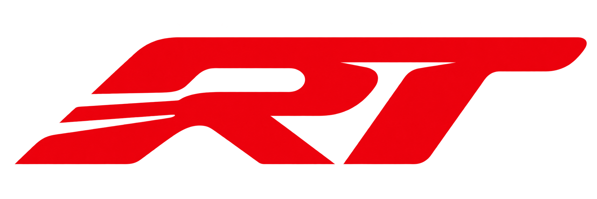

# F1 Reaction Test

English | [简体中文](README.zh-CN.md)



A 2D racing-start reaction game built with **Godot 4.7.2 and GDScript**. This is my first independent game development learning project.

Start a round, wait for all five red lights to go out, then click the same button again to measure your reaction time.

## How to play

1. Click **🟢 START** to begin.
2. Five red light groups illuminate sequentially, **one second apart**.
3. Once the fifth group lights up, all lights remain on for a random **0.2–3 seconds**.
4. When all red lights go out together, click the button as quickly as possible.
5. Your reaction time appears in seconds, for example `0.213 s`. Lower is faster.
6. Click **BACK** to return to the initial START screen. Click START again to begin another round.

Clicking before the lights go out results in a **FALSE START**. Click BACK to return to the initial screen.

Use the mouse; the space bar is not required. Timing starts when the lights go out and stops when the button is pressed.

> This game is for entertainment and learning. Display, input-device, and runtime latency affect the result, so it is not a precision physiological measurement. The 0.2–3-second hold is a simulation setting, not a claim about a mandatory interval in current F1 regulations.

## Features

- Five automatic, sequential red lights with simultaneous lights-out.
- A random hold after the fifth light.
- False-start detection.
- Reaction times displayed in seconds to three decimal places.
- An explicit return to START after a result or false start.
- English interface text with emoji and Chinese code comments.
- A Windows build exported and tested locally.

## Running the game

### Windows build

Download published Windows builds from this repository's [Releases](https://github.com/uim-g/f-1-reaction/releases). Access depends on the repository's visibility and your permissions.

If you have a Windows export package:

1. Extract the entire archive into one folder.
2. Run `F1ReactionTest.exe`.
3. For the v0.1.1 Windows build, project resources are embedded in the EXE; a separate PCK file is not required. The older v0.1.0 build requires its matching `F1ReactionTest.pck` beside the EXE. Keep any other accompanying runtime files in their original relative locations.

Players do not need the Godot editor to run an exported build.

### Run from source

1. Install the **standard edition of Godot 4.7.2**. This project uses GDScript, so the .NET edition is not required.
2. Download or clone this repository.
3. In the Godot Project Manager, click **Import** and select `project.godot`.
4. Open the project and wait for its assets to finish importing.
5. Press **F5** to run the project or **F8** to stop it.

The current project uses the **Forward+** renderer and **Direct3D 12** on Windows. The runtime environment must support these settings.

### Web version

A web build is not available yet. Planned work includes configuring the Compatibility renderer and Web export, testing in a browser, and then providing a play link.

## Project structure

```text
.
├── project.godot                 # Project settings and main scene
├── main.tscn                     # Title, logo, lights, and button
├── main.gd                       # Light sequence, false starts, and timing
├── main.gd.uid                   # Godot script resource identifier
├── Reaction-Test-logo.png        # Game interface logo
├── Reaction-Test-logo.png.import # Image import settings
├── export_presets.cfg            # Export configuration
├── .gitignore                    # Cache and local build exclusions
├── LICENSE                       # MIT license
├── README.md                     # English documentation
└── README.zh-CN.md               # Simplified Chinese documentation
```

The `.godot/` directory contains generated caches and is recreated by Godot. It is excluded from version control. Local Windows build files are also excluded by `.gitignore` and can be distributed separately as release packages.

## Adjusting the timing

The following constants at the top of `main.gd` control the sequence. All values are in seconds:

```gdscript
const LIGHT_INTERVAL: float = 1.0
const MIN_WAIT: float = 0.2
const MAX_WAIT: float = 3.0
```

- `LIGHT_INTERVAL`: time between consecutive light groups turning on.
- `MIN_WAIT`: shortest hold after the fifth light turns on.
- `MAX_WAIT`: longest hold after the fifth light turns on.

Run the project again after making changes.

## Project status and licensing

This is an unofficial personal learning project. It is not affiliated with, authorized by, or endorsed by Formula 1, the FIA, or related organizations.

This project is licensed under the [MIT License](LICENSE). Copyright (c) 2026 uim-g. Third-party components and assets, if any, remain subject to their respective licenses. This license does not grant rights to third-party names or trademarks.

This project uses **Godot Engine**, which is available under the MIT license. See the [Godot Engine License](https://godotengine.org/license/). The engine license is separate from the licensing of this project's code, logo, and other assets.
